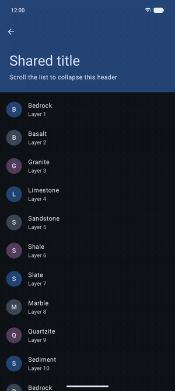
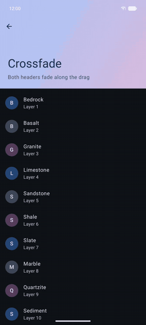
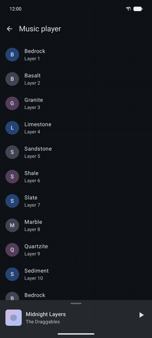
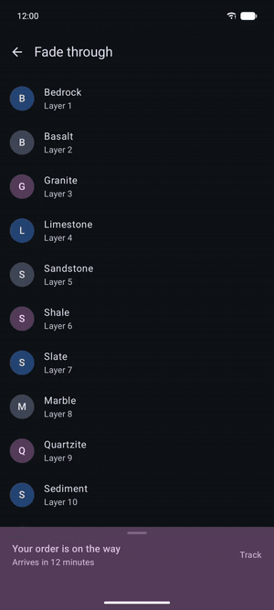
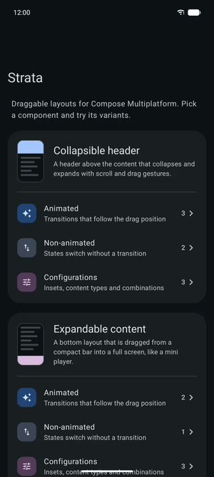

<h1 align="center">Strata</h1>

<p align="center">
  <b>Draggable, layered layouts for Compose Multiplatform.</b><br>
  Collapsible headers and expandable bottom content whose animations follow your finger.
</p>

<p align="center">
  
  
  
  
</p>

<table align="center">
  <tr>
    <td align="center"></td>
    <td align="center"></td>
    <td align="center"></td>
    <td align="center"></td>
  </tr>
  <tr>
    <td align="center"><sub>Shared title</sub></td>
    <td align="center"><sub>Crossfade</sub></td>
    <td align="center"><sub>Music player</sub></td>
    <td align="center"><sub>Fade through</sub></td>
  </tr>
</table>

## ✨ Features

- **Gesture driven.** Layouts follow scroll and drag gestures continuously and settle at the
  closest state, based on position and velocity.
- **Seekable animations.** Transitions between the states are seeked by the drag position, so
  `animateEnterExit`, `sharedElement` and `sharedBounds` move exactly with the finger.
- **Measured from your content.** Collapsed and expanded sizes come from the slots themselves.
  No hardcoded heights.
- **Insets aware.** Window insets are consumed by the container and handed to the slots as
  `PaddingValues`.
- **State restoration.** The settled state survives configuration changes and process death.
- **Multiplatform.** One API for Android and iOS.

## 🧱 Components

| Component | What it does |
| --- | --- |
| `CollapsibleHeaderContainer` | A header above the content that collapses with scrolling and switches between an expanded and a collapsed header. |
| `AnimatableCollapsibleHeaderContainer` | The same container, with a transition between both headers that follows the drag. |
| `ExpandableContent` | A bottom layout that is dragged from a compact bar into a full screen, like a mini player. |

All components settle in one of the two `DraggableLayoutState`s: `Collapsed` or `Expanded`.

## 📦 Installation

Strata is published to Maven Central. Add the dependency to the common source set of your shared
module:

```kotlin
// build.gradle.kts of your shared module
kotlin {
    sourceSets {
        commonMain.dependencies {
            implementation("dev.leonp.strata:gesture-draggable:<version>")
        }
    }
}
```

## 🚀 Usage

### Collapsible header

The header collapses before the content scrolls and expands again once the content reached its
start. Apply the `PaddingValues` handed to each slot, they contain the window insets.

```kotlin
CollapsibleHeaderContainer(
    expandedHeader = { padding ->
        Text(
            text = "Expanded header",
            style = MaterialTheme.typography.headlineMedium,
            modifier = Modifier
                .fillMaxWidth()
                .background(MaterialTheme.colorScheme.primaryContainer)
                .padding(padding)
                .padding(24.dp),
        )
    },
    collapsedHeader = { padding ->
        Text(
            text = "Collapsed header",
            style = MaterialTheme.typography.titleMedium,
            modifier = Modifier
                .fillMaxWidth()
                .background(MaterialTheme.colorScheme.primaryContainer)
                .padding(padding)
                .padding(16.dp),
        )
    },
) { padding ->
    LazyColumn(contentPadding = padding) {
        items(50) { index -> Text("Item $index", Modifier.padding(16.dp)) }
    }
}
```

Leave out `collapsedHeader` to let the header collapse down to the top insets, and pass
`insets = WindowInsets(0, 0, 0, 0)` when a parent, such as a `Scaffold`, already handles them.

### Animated collapsible header

`AnimatableCollapsibleHeaderContainer` runs a transition between both headers. Its header slots
are an `AnimatableCollapsibleHeaderScope`, so shared elements and enter and exit animations work
directly:

```kotlin
SharedTransitionLayout {
    AnimatableCollapsibleHeaderContainer(
        expandedHeader = { padding ->
            Column(Modifier.fillMaxWidth().padding(padding).padding(24.dp)) {
                Text(
                    text = "Strata",
                    style = MaterialTheme.typography.displaySmall,
                    modifier = Modifier.sharedBounds(
                        sharedContentState = rememberSharedContentState("title"),
                        animatedVisibilityScope = this@AnimatableCollapsibleHeaderContainer,
                    ),
                )
                Text(
                    text = "Scroll to collapse",
                    modifier = Modifier.animateEnterExit(
                        enter = fadeIn(tween(400, delayMillis = 600, easing = LinearEasing)),
                        exit = fadeOut(tween(400, easing = LinearEasing)),
                    ),
                )
            }
        },
        collapsedHeader = { padding ->
            Text(
                text = "Strata",
                style = MaterialTheme.typography.titleLarge,
                modifier = Modifier
                    .padding(padding)
                    .padding(16.dp)
                    .sharedBounds(
                        sharedContentState = rememberSharedContentState("title"),
                        animatedVisibilityScope = this@AnimatableCollapsibleHeaderContainer,
                    ),
            )
        },
    ) { padding ->
        LazyColumn(contentPadding = padding) { /* … */ }
    }
}
```

### Expandable content

Place `ExpandableContent` at the bottom of a full size parent, so it grows upwards. The content
lambda receives the state to show and runs in an `ExpandableContentScope`:

```kotlin
SharedTransitionLayout {
    Box(Modifier.fillMaxSize()) {
        ScreenContent()

        ExpandableContent(
            modifier = Modifier
                .align(Alignment.BottomCenter)
                // The background belongs to the layout, so it grows with the drag right away.
                .background(MaterialTheme.colorScheme.surfaceContainerHigh),
        ) { layoutState ->
            when (layoutState) {
                DraggableLayoutState.Collapsed -> MiniPlayer(
                    modifier = Modifier.windowInsetsPadding(WindowInsets.navigationBars),
                )

                DraggableLayoutState.Expanded -> FullPlayer(
                    modifier = Modifier.windowInsetsPadding(WindowInsets.systemBars),
                )
            }
        }
    }
}
```

Inside `MiniPlayer` and `FullPlayer`, give elements that exist in both states the same
`rememberSharedContentState` key, and fade everything else with `animateEnterExit`.

### 🎞️ Animating along the drag

Transitions are **seeked** by the drag position instead of played over time. Seeking maps the drag
progress linearly onto the total duration of the transition, so durations and delays define *where*
in the drag an animation runs:

```kotlin
// Total duration: 1000 ms. This fades in during the last 20 % of the drag.
fadeIn(tween(durationMillis = 200, delayMillis = 800, easing = LinearEasing))

// And this fades out during the first 20 %.
fadeOut(tween(durationMillis = 200, easing = LinearEasing))
```

A few tips:

- Use `tween` specs on one shared timeline. The duration of a `spring` is only estimated and
  silently changes the total duration.
- Pass a linear `tween` as the `boundsTransform` of shared elements, so they move evenly along
  the drag.
- The slots are **composed more than once** to measure both sizes. Hoist state that changes their
  size, and do not run analytics or impression tracking from composition.

### Holding the state

Hoist the state to keep it outside of the layout. It saves the settled state automatically:

```kotlin
val headerState = rememberCollapsibleHeaderContainerState()
val expandableState = rememberExpandableContentState()
```

## 📱 Demo app



The [demo](./demo) module shows every component in all its states. Its home screen is grouped by
component, each with sub menus for **animated** variants, **non-animated** variants and other
**configurations**, such as content that does not scroll, custom insets and both components on one
screen. Navigation is built with [Navigation 3](https://developer.android.com/guide/navigation/navigation-3).

- **Android:** `./gradlew :androidApp:installDebug`
- **iOS:** open [iosApp](./iosApp) in Xcode and run it.

<br clear="right">

## 🗂️ Project structure

| Module | Contents |
| --- | --- |
| [`strata/gesture/draggable`](./strata/gesture/draggable) | The library, published as `gesture-draggable`: collapsible headers and expandable content. |
| [`strata/gesture/draggable-previews`](./strata/gesture/draggable-previews) | The unpublished Compose previews of the library. |
| [`theme`](./theme) | The shared Material 3 theme of the demo and the previews. |
| [`demo`](./demo) | The shared demo app with Navigation 3. |
| [`androidApp`](./androidApp), [`iosApp`](./iosApp) | The platform entry points of the demo. |

## 📄 License

```
Copyright 2026 PrimoDev23

Licensed under the Apache License, Version 2.0 (the "License");
you may not use this file except in compliance with the License.
You may obtain a copy of the License at

    http://www.apache.org/licenses/LICENSE-2.0

Unless required by applicable law or agreed to in writing, software
distributed under the License is distributed on an "AS IS" BASIS,
WITHOUT WARRANTIES OR CONDITIONS OF ANY KIND, either express or implied.
See the License for the specific language governing permissions and
limitations under the License.
```
